<p align="center">
  
</p>

<p align="center">
  <a href="https://bnsolutions.cl/lectures"><b>bnsolutions.cl/lectures</b></a> &nbsp;·&nbsp;
  <!-- TODO: replace with the YouTube link once the teaser is published -->
  <a href="TODO-youtube-link"><b>Watch the teaser</b></a> &nbsp;·&nbsp;
  <a href="https://bnsolutions.cl"><b>B&N Solutions</b></a> &nbsp;·&nbsp;
  <a href="README.md">Leer en español</a>
</p>

B&N Lectures are animated classes in mathematics, physics, computing, chaos and geometry, made by B&N Solutions. This repository holds the full source of its teaser (93 seconds, no narration, cut to a song, in 4:5, 16:9 and 9:16) and the library of the 192 simulations and effects that came out of B&N's videos so far.

It rests on one rule: **every frame is a function of time and of the music.** No scene keeps state between frames, so any frame can be rendered on its own, in any order and in parallel, and it comes out the same. And every scene is real physics or mathematics: the double slit solves the Schrödinger equation, field lines are integrated with RK4, and the Lorenz attractor runs with a million particles.

### `// 01` What's here

| | |
|---|---|
| **The full teaser** | A [Remotion](https://www.remotion.dev) project with three compositions: `Clase` (4:5, 1080×1350), `ClaseYT` (16:9, 1920×1080) and `ClaseTT` (9:16, 1080×1920, inside TikTok's safe area). Same timing and scenes; only the layout of each frame changes. |
| **A hybrid engine** | Scenes in 2D canvas (`src/escenas.ts`) and in WebGL2 (`src/gl.ts`): a raymarched black hole, a prism, DNA, Lorenz and ink. On top, a retro CRT look with phosphor bloom, scanlines, curvature, grain, and chromatic aberration on the hits. |
| **Precomputed simulations** | 2D Schrödinger, Gray-Scott reaction-diffusion and LIC textures of a two-charge field, in Python with numpy. One command regenerates them, byte for byte. |
| **Locked to the song** | A rhythm map with every string note, kick, snare, impact and braam of the song, in seconds. Every cut, pulse and line of text is anchored to those times. |
| **The library** | A catalog of 192 simulations and effects, each with a thumbnail, its equation or model, where it came from and how reusable it is, plus seven modules ready to copy. |

### `// 02` The scenes and their science

The ten lead scenes, as they appear in the 16:9 cut:

<table>
  <tr>
    <td width="50%" valign="top">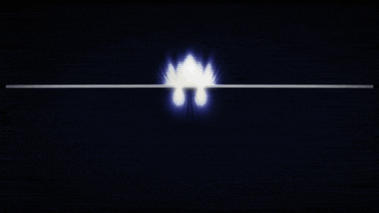<br><b>Quantum fluid and double slit</b><br><sub>iħ ∂ψ/∂t = −(ħ²/2m) ∇²ψ + Vψ, split-step Fourier; the fringes come from |ψ|²</sub></td>
    <td width="50%" valign="top">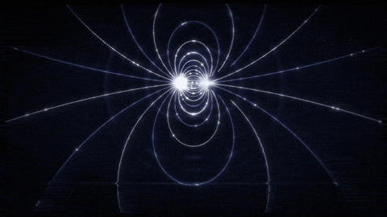<br><b>Dipole field</b><br><sub>E = Σ k qᵢ r̂ᵢ / rᵢ², lines integrated with adaptive-step RK4</sub></td>
  </tr>
  <tr>
    <td width="50%" valign="top">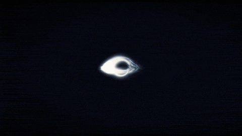<br><b>Black hole</b><br><sub>Rays bent with a = −(3/2) r_s h² r̂ / r⁴ and a thin disk with Doppler beaming; the well is Flamm's paraboloid</sub></td>
    <td width="50%" valign="top">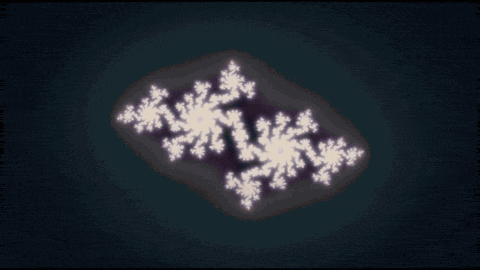<br><b>Mandelbrot and Julia</b><br><sub>z ↦ z² + c, with smooth iteration count and distance estimation</sub></td>
  </tr>
  <tr>
    <td width="50%" valign="top">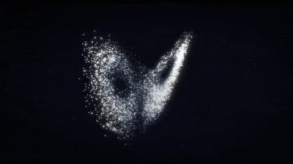<br><b>Lorenz attractor</b><br><sub>ẋ = σ(y − x), ẏ = x(ρ − z) − y, ż = xy − βz, with σ = 10, ρ = 28, β = 8/3; a million particles</sub></td>
    <td width="50%" valign="top">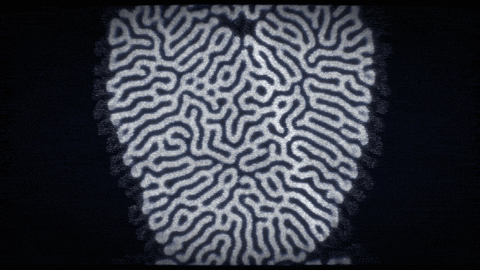<br><b>Chladni figures</b><br><sub>Nodal lines of cos(nπx) cos(mπy) − cos(mπx) cos(nπy) = 0; 100,000 grains jump on every hit</sub></td>
  </tr>
  <tr>
    <td width="50%" valign="top">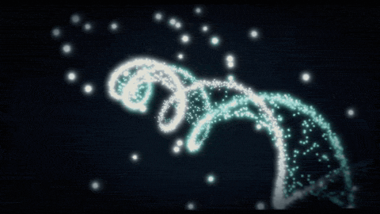<br><b>Double helix</b><br><sub>A parametric helix of about 180,000 particles with base pairs and depth of field</sub></td>
    <td width="50%" valign="top">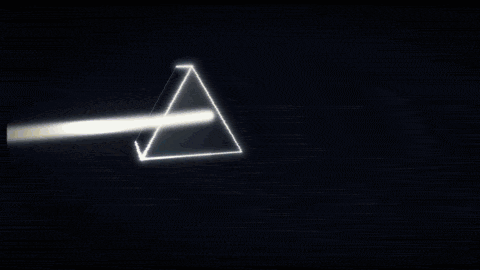<br><b>Newton's prism</b><br><sub>Dispersion over 44 wavelengths and raymarched glass with Fresnel</sub></td>
  </tr>
  <tr>
    <td width="50%" valign="top">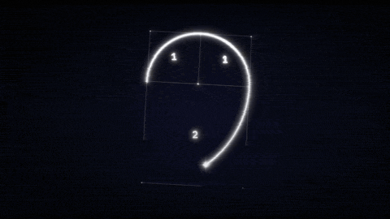<br><b>Fibonacci and the sunflower</b><br><sub>Golden spiral with φ = (1 + √5)/2; Vogel's sunflower: r = c√k, θ = k · 137.508°</sub></td>
    <td width="50%" valign="top">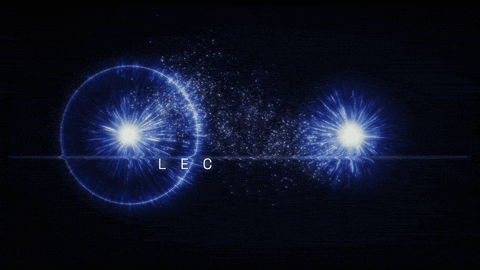<br><b>The ending</b><br><sub>Animated LIC of the two-charge field (Cabral and Leedom, Forssell); the charges write LEC, TUR and ES</sub></td>
  </tr>
</table>

The full sequence, in the order of the video:

| Part | Scenes | Science |
|---|---|---|
| The small | Charge and rays → Lissajous → Bohr atom → orbital → quantum fluid → waves | 1/r² radial field, Lissajous curves, orbits rₙ ∝ n², \|ψ\|² density, 2D Schrödinger, interfering Huygens sources |
| Space | Dipole field → black hole → well → orbit → three bodies | Field lines, Schwarzschild curvature, Flamm's paraboloid, a precessing orbit, the Chenciner–Montgomery figure-eight orbit (G = m = 1, Verlet) |
| The search | RRT tree → tesseract | A rapidly-exploring random tree that grows with every note; a (±1)⁴ hypercube rotating in the XW and YZ planes, projected from 4D to 3D |
| The complex | Ink → Mandelbrot and Julia → Lorenz → Gray-Scott → Chladni | Domain warping over fbm noise, fractals, deterministic chaos, reaction-diffusion (F = 0.055, k = 0.062) seeded with the Lorenz silhouette, modes of a vibrating plate |
| Form | DNA → prism → golden spiral → sunflower → nautilus | Double helix, dispersion, the golden ratio, phyllotaxis |
| The ending | The star → "TÚ" → the mark | Particles landing on the pixels of the mark over the dipole's LIC |

### `// 03` How it locks to the music

The animation was first designed on a fixed 120 BPM grid (one beat = 0.5 s). It was then cut to "Unbreakable Spirit", which runs at 129.98 BPM:

1. **Analysis.** `datos/analisis-cancion.json` holds the song's timing: beats, downbeats, phrases, impacts, braams, risers, silences and per-band onsets. Times only, no audio.
2. **Conform.** `herramientas/conform_pulso.py` makes each animation beat one beat of the song (0.4616 s). Everything runs 8.3 % faster; scenes are fitted by repeating or removing whole beats, and their starts, ends and transitions are left alone. It writes `src/ritmo.json`.
3. **Edit.** The song is edited by whole bars (`herramientas/editar_cancion.py`): every splice lands on a downbeat, with a 20 ms equal-power crossfade. It ends up at 93.28 s.
4. **Real events.** `herramientas/ritmo_cancion.py` detects the 469 notes of the string ostinato, with their 3+3+2 accents, and the drums (`src/cancion.json`). Each note sends a thin glint across the lights in the frame; each hit, a sweep and a 0.7 % camera push. `herramientas/eventos_reales.py` finds the three drops of the coda (88.62 · 89.08 · 89.55 s), which write LEC, TUR and ES.
5. **Reading.** `src/ritmo.ts` reads those maps and converts them to scene time. Scenes only ask "what happens at second t?".

`herramientas/sincronia_audio.py` and `herramientas/correlacion_onsets.py` measure sync on the finished mp4.

### `// 04` Reproducing it

**Requirements**

| | Version | Notes |
|---|---|---|
| Node.js | 20 or later (tested with 20.20) | With npm |
| Remotion | 4.0.534 | Pinned in `teaser/package.json`; `npm ci` installs it and the first run downloads Chrome Headless Shell. Remotion has its own license: see [remotion.dev/license](https://www.remotion.dev/license) |
| Python | 3 (tested with 3.14) | With `numpy`, `imageio-ffmpeg` (ships its own ffmpeg) and `pillow`, at the versions in `teaser/requirements.txt` |
| WebGL2 | Chrome with ANGLE | `remotion.config.ts` and the tools ask for `gl: "angle"`. Tested on macOS with Apple Silicon |

**1. Install**

```bash
git clone https://github.com/4mser/bn-lectures.git
cd bn-lectures/teaser
npm ci
python3 -m venv .venv && source .venv/bin/activate
pip install -r requirements.txt
```

**2. Get the music.** Pixabay's license does not allow redistributing the file on its own, so it is not in the repository. Download ["Unbreakable Spirit (Action Cinematic Epic)"](https://pixabay.com/music/adventure-unbreakable-spirit-action-cinematic-epic-591786/) by RaspberryMusic and save it as:

```
teaser/musica/raspberrymusic-unbreakable-spirit-action-cinematic-epic-591786.mp3
```

To keep it somewhere else, pass its path in `CANCION=/path/to/file.mp3`. Then build the soundtrack:

```bash
python herramientas/sonidos_lectures.py     # → public/musica.wav (song edited by bars, −1 dBFS)
```

The track comes out byte-identical to the one in the published video. The timing maps (`src/ritmo.json` and `src/cancion.json`) are already in the repository.

**3. Generate the assets.** About two minutes on an Apple Silicon Mac:

```bash
python herramientas/lic.py                  # → public/img/campo-{45,169,916}.png
python herramientas/lic_animada.py          # → public/img/campo-{45,169,916}/fNN.jpg (60-frame loop)
for f in 45 169 916; do
  FORMATO=$f python herramientas/cuantico.py    # → public/sim/q, q-169, q-916
  FORMATO=$f python herramientas/grayscott.py   # → public/sim/gs, gs-169, gs-916
done
```

| Script | What it computes | Variables |
|---|---|---|
| `lic.py` | Static LIC texture of the two-charge field, one per format | — |
| `lic_animada.py` | Animated LIC for the ending: strands flow from +q to −q in a seamless 2 s loop | Formats as arguments (`45 169 916`); all three by default |
| `cuantico.py` | 2D Schrödinger by split-step Fourier: the packet crosses the double slit | `FORMATO=45` (default), `169` or `916` |
| `grayscott.py` | Gray-Scott seeded with the Lorenz attractor's silhouette as seen on screen | `FORMATO=45`, `169` or `916` |
| `marca.py` | Outlines and points of the mark for `src/marca.json` (already versioned) | Only if you change `bn-mark.png` |

**4. Check and render**

```bash
npx tsc --noEmit
node herramientas/cuadros.mjs out/cuadros 900,2700 ClaseYT   # single frames, by frame number (30 fps)
npm run dev                                                   # Remotion Studio, to scrub the timeline

python herramientas/render.py 300 4 Clase     # → out/BN-Lectures-teaser.mp4       (4:5)
python herramientas/render.py 300 4 ClaseYT   # → out/BN-Lectures-teaser-16x9.mp4  (16:9)
python herramientas/render.py 300 4 ClaseTT   # → out/BN-Lectures-teaser-9x16.mp4  (9:16)
```

`render.py` takes the chunk size in frames, the concurrency and the composition. It renders in chunks, each in its own process with retries, joins them without re-encoding and adds `public/musica.wav`. If it stops, run it again and it picks up after the last finished chunk. If you change the music, delete `out/partes*/` first.

**Optional: regenerate the timing maps.** From the analysis in `datos/`, `python herramientas/conform_pulso.py` followed by `python herramientas/eventos_reales.py` rewrites `src/ritmo.json` byte for byte. `src/cancion.json` comes from the unedited song: decode it to `public/musica.wav` (`ffmpeg -i musica/<song>.mp3 -ar 48000 public/musica.wav`), run `SALIDA=src/cancion.json python herramientas/ritmo_cancion.py`, and go back to step 2.

### `// 05` The library of 192 simulations

[`biblioteca/`](biblioteca/README.md) catalogs every simulation and effect in B&N's videos: the electromagnetism series, the original reel and every version of the teaser. Each entry has a thumbnail, what it shows (with its equation or model), the file and function it came from, what it depends on and how reusable it is. The catalog is written in Spanish.

| Category | Entries | | Category | Entries |
|---|---|---|---|---|
| Electric field | 79 | | Quantum | 6 |
| Endings and logo | 16 | | Fractals | 6 |
| Engines and post-processing | 16 | | Computing and AI | 5 |
| Typography and credits | 15 | | Chaos | 4 |
| Gravity and orbits | 13 | | Fluids | 2 |
| Music and audio analysis | 10 | | Probability | 2 |
| Waves | 9 | | Geometry and topology | 9 |

The seven modules in `biblioteca/modulos/` are clean copies of the most reusable pieces, each with a `LEEME.md`: the WebGL2 engine (`motor-gpu`), the LIC textures (`lic`), music analysis and sync checks (`analisis-musica`), the Fourier-epicycle ending (`final-epiciclos`), the chained FDTD → Schrödinger → fluid → Gray-Scott → Ising simulator (`simulador-v6`), the series' canvas helpers (`lab-serie`) and the numpy music generators (`musica`).

The catalog names B&N working projects that are not in this repository; of those, the final teaser and the modules are published.

### `// 06` Layout

```
teaser/
  src/                 Root.tsx (compositions) · Video.tsx (canvas, look and layers) · escenas.ts · gl.ts · final.ts
                       titulos.ts · rotulos.ts · disposicion.ts (each format) · ritmo.ts + ritmo.json · cancion.json
  herramientas/        simulations, LIC, song editing and analysis, chunked render, frame review
  datos/               timing analysis of the song (no audio)
  audio/               synthetic music generator from the first versions (not in the current pipeline)
  musica/              the song's mp3 goes here (not versioned)
  public/              fonts and bn-mark.png; the tools write sim/, img/campo-* and musica.wav here
  README.md            development log, version by version (Spanish)
biblioteca/
  README.md            catalog of 192 simulations
  miniaturas/          one image per entry
  modulos/             reusable pieces with their LEEME.md
  datos/ herramientas/ the catalog as data and the scripts that build the README and thumbnails
docs/assets/           GIFs and SVG for this README
```

### `// 07` Credits

- **Made by** [B&N Solutions](https://bnsolutions.cl).
- **Music:** "Unbreakable Spirit (Action Cinematic Epic)" by RaspberryMusic, on [Pixabay](https://pixabay.com/music/adventure-unbreakable-spirit-action-cinematic-epic-591786/), under the Pixabay Content License. Not included in the repository.
- **Fonts:** Space Grotesk and IBM Plex Mono, under the SIL Open Font License 1.1 (`teaser/public/fonts/OFL.txt`).
- **Tools:** Remotion, React, TypeScript, WebGL2, numpy, Pillow and imageio-ffmpeg.
- **Other people's techniques:** line integral convolution (Cabral and Leedom) and its animated form (Forssell), the three-body figure-eight orbit (Chenciner and Montgomery), Vogel's sunflower model, the Lorenz system and Gray and Scott's reaction-diffusion.

### `// 08` License

Code and documentation are under the [MIT License](LICENSE), © 2026 B&N Solutions.

**The brand is excluded.** The B&N Solutions name, the B&N mark and logo, and the name "B&N Lectures" are not under MIT: they remain B&N Solutions', all rights reserved. `teaser/public/img/bn-mark.png` is included only because the render needs it. If you make your own video with this code, swap in your own mark. Details in [TRADEMARKS.md](TRADEMARKS.md).

The song is not redistributed, and the fonts and npm dependencies keep their own licenses.

---

<p align="center">
  
</p>
